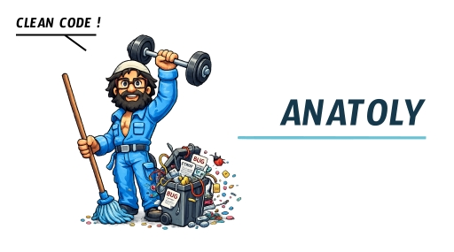
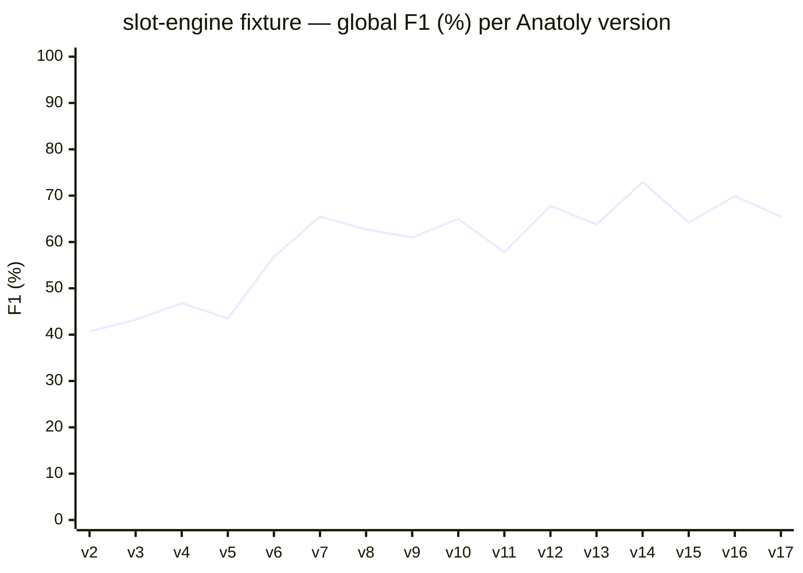

<p align="center">
  
</p>

# Anatoly

*"Can I clean here?"*

**Like a senior code reviewer — that has to show its work.**

Anatoly is a deep-audit agent for existing codebases. It surfaces duplicates,
dead code, silent bugs, over-engineering, and broken best practices — and
**proves every finding with a file, a line, and the evidence trail that led
to it.** No code is modified.

Built for the codebases that grew faster than anyone could review them —
especially the ones shipped with Cursor, Claude Code, Lovable, v0, Bolt,
or Windsurf.

[](https://anatoly.cloud/) [](https://nodejs.org/) [](https://www.typescriptlang.org/) [](https://www.gnu.org/licenses/agpl-3.0)

```bash
npx @r-via/anatoly@latest run   # one command, full codebase audit
```

---

## The problem

You shipped fast. Maybe with AI, maybe with a sprint that never ended.
Now the codebase has:

- functions that do the same thing under different names,
- exports nobody imports,
- silent logic bugs the type system can't catch,
- bespoke abstractions wrapping three values,
- "tested" code with no behavioral coverage.

Linters won't find this. Type checkers won't either. A senior reviewer
would — if they had a week. **Anatoly does it in minutes, and gives you a
report you can defend.**

---

## What a run looks like

<p align="center">
  
</p>

You run one command. A few minutes later, you get a report like this:

> **15 files reviewed in 10 min — $6.13 in AI analysis so you don't have to.**
> Verdict: **NEEDS_REFACTOR** · 26 findings in 11 files
>
> | Axis | Health |
> |------|--------|
> | Correction      | 🟥🟥🟥🟥🟥🟥🟥🟥🟥⬜ 93% OK |
> | Utility         | 🟥🟥🟥🟥🟥🟥🟥🟥⬜⬜ 83% used |
> | Duplication     | 🟥🟥🟥🟥🟥🟥🟥🟥🟥⬜ 90% unique |
> | Overengineering | 🟩🟩🟩🟩🟩🟩🟩🟩🟩⬜ 90% lean |
> | Best Practices  | 🟥🟥🟥🟥🟥🟥🟥⬜⬜⬜ avg 7.4 / 10 |

And findings like these — each one with file+line, a verdict, and the evidence that produced it:

- 🐛 **`src/engine.ts` `computePayout`** — the house-edge multiplier sign is inverted: it *boosts* payout instead of reducing it. RTP is broken.
- 🐛 **`src/rng.ts` `weightedPick`** — `Math.random()` used as the RNG source in a function whose own docstring says *"suitable for gaming RNG applications"*.
- ♻️ **`src/types.ts` `LegacySpinResult`** — exported, imported by 0 files.
- 📋 **`src/engine.ts` `checkLine`** ⇄ **`src/paytable.ts` `lineWins`** — semantically identical (RAG cosine 0.852): same WILD-skip, same consecutive-match loop, different names. A textual diff would never see it.
- 🏗️ **`src/engine.ts` `EngineContainer`** — bespoke IoC container backed by a stringly-typed `Map<string, unknown>`, holding three values.

**One command. Full codebase. Evidence-backed findings. No code modified.**

Languages: TypeScript, Python, Rust, Go, Java, C#, Bash, SQL, YAML, JSON.

---

## Who runs Anatoly

| If you are… | You use Anatoly to… |
|---|---|
| **A senior dev or tech lead** shipping AI-generated code | Surface the duplicates, dead code, and silent bugs your AI tools left behind. |
| **A team on a Claude or Cursor subscription** | Get Opus-grade deliberation on every audit — at **$0 per token**. |
| **A regulated org** (finance, health, defense) | Audit **air-gapped** — embeddings local, LLM-optional local, **no source byte leaves your network**. |
| **An M&A or legal expert** doing tech due diligence | Produce reports that **survive counter-expertise** — every claim pinned to file, line, and evidence. |
| **A DevOps team** running CI/CD quality gates | Audit every PR with structured JSON output for your pipeline. |

---

## Why the findings hold up

- **Evidence-backed** — every finding is grep'd, read, and cross-referenced before it's reported. No hallucinated issues.
- **Semantic duplicate detection** — finds functions that *do the same thing* even when they look nothing alike.
- **Deliberation pass** — multi-LLM arbitration on disputed findings.
- **$0 on unchanged code** — SHA-256 cache. Re-running on a clean repo costs nothing.
- **Run and walk away** — Telegram when done. Watch mode and Claude Code hook for write → audit → fix loops.
- **Local by default** — embeddings run on your machine. With Claude Code subscription, no API key needed.

> Fair warning: this is context-and-time-hungry by design. Dream-quality code doesn't come cheap — it takes serious effort (and tokens) to get there.

---

## Measured accuracy

Anatoly is benchmarked against [anatoly-bench](https://github.com/r-via/anatoly-bench) — fixtures seeded with curated defects (bugs, dead code, semantic duplicates, over-engineering) and scored by F1 against a ground-truth catalog.



Per-axis curves, change-log, and remaining misses: [slot-engine results](https://github.com/r-via/anatoly-bench/blob/main/docs/02-slot-engine-results.md).

---

## Getting started

```bash
# One-off run
npx @r-via/anatoly@latest run

# Or install globally
npm install -g @r-via/anatoly
anatoly run
```

**Prerequisites:** Node.js >= 20.19, plus one LLM auth path:

- **Claude Code subscription** (default) — no API key needed
- **Gemini CLI** — Google OAuth, $0/token
- **BYOK** — `ANTHROPIC_API_KEY`, `GOOGLE_GENERATIVE_AI_API_KEY`, etc.
- **Local** — Ollama, LM Studio, vLLM

See [Installation](docs/01-Getting-Started/01-Installation.md) and [Recommended LLM Setup](docs/01-Getting-Started/03-Recommended-LLM-Setup.md).

### Optional: GPU embeddings

For better duplication detection, set up GGUF mode (Docker + NVIDIA GPU ≥ 12 GB VRAM):

```bash
npx anatoly local-embeddings upgrade
```

---

## Common commands

```bash
npx anatoly run                # Full audit
npx anatoly watch              # Daemon: incremental re-audit on change
npx anatoly estimate           # Forecast tokens, cost, time — no API calls
npx anatoly runs attach        # Inspect a run (live or finished)
npx anatoly reset              # Wipe all state
```

> Full CLI: [docs/03-CLI-Reference/](docs/03-CLI-Reference/01-Commands.md). Configuration: [docs/01-Getting-Started/02-Configuration.md](docs/01-Getting-Started/02-Configuration.md).

---

## Documentation

| Section | Highlights |
|---------|------------|
| [Getting Started](docs/01-Getting-Started/) | [Vision](docs/01-Getting-Started/00-Vision.md), [Installation](docs/01-Getting-Started/01-Installation.md), [Configuration](docs/01-Getting-Started/02-Configuration.md) |
| [Architecture](docs/02-Architecture/) | [Pipeline](docs/02-Architecture/01-Pipeline-Overview.md), [7-Axis System](docs/02-Architecture/02-Seven-Axis-System.md), [RAG Engine](docs/02-Architecture/03-RAG-Engine.md), [Deliberation](docs/02-Architecture/05-Deliberation-Pass.md) |
| [CLI Reference](docs/03-CLI-Reference/) | [Commands](docs/03-CLI-Reference/01-Commands.md), [Global Options](docs/03-CLI-Reference/02-Global-Options.md) |
| [Integration](docs/05-Integration/) | [Claude Code Hooks](docs/05-Integration/01-Claude-Code-Hooks.md), [CI/CD](docs/05-Integration/02-CI-CD.md), [Watch Mode](docs/05-Integration/03-Watch-Mode.md), [Telegram](docs/05-Integration/04-Telegram-Notifications.md) |
| [Design Decisions](docs/07-Design-Decisions/) | [Why Local RAG](docs/07-Design-Decisions/01-Why-Local-RAG.md), [Evidence-Based](docs/07-Design-Decisions/02-Evidence-Based-Approach.md) |

---

## Development

```bash
git clone https://github.com/r-via/anatoly.git
cd anatoly
npm install
npm run dev        # Run with tsx
npm run build      # Build with tsup
npm test           # Vitest
npm run typecheck  # tsc --noEmit
```

## Contributing

1. Fork, branch (`feat/my-feature`)
2. `npm test && npm run typecheck`
3. Open a PR

By contributing, you agree to the [Contributor License Agreement](CLA.md) (Anatoly uses dual licensing: AGPL-3.0 + commercial).

## License

Dual-licensed:

- **Open source** — [AGPL-3.0](https://www.gnu.org/licenses/agpl-3.0): free for open source, personal, and academic use.
- **Commercial** — proprietary license available. See [COMMERCIAL.md](COMMERCIAL.md).

## Contact

- Website: [anatoly.cloud](https://anatoly.cloud/)
- Issues: [github.com/r-via/anatoly/issues](https://github.com/r-via/anatoly/issues)

<!-- checked-by-anatoly -->
[](https://github.com/r-via/anatoly)
<!-- /checked-by-anatoly -->
